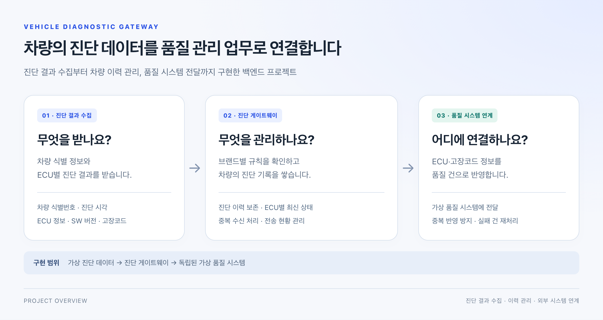
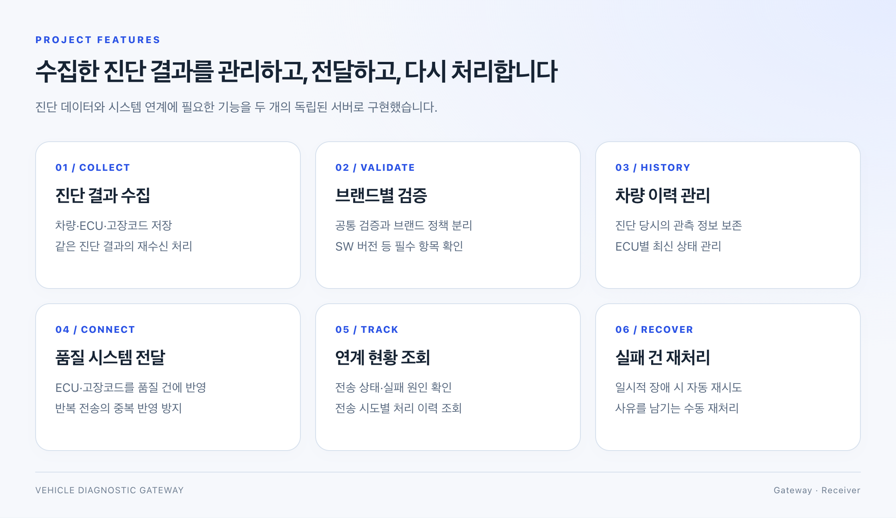

# Vehicle Diagnostic Gateway

**차량 진단 결과를 수집하고 품질 관리 시스템으로 전달하는 백엔드 프로젝트입니다.**

차량 한 대의 진단 결과에는 여러 ECU(전자제어장치)의 정보와 DTC(고장코드)가 포함됩니다. 이 프로젝트는 그 결과를 받아 차량별 이력으로 저장하고 ECU별 최신 진단 상태를 관리하며 고장코드를 품질 시스템의 관리 데이터로 연결합니다.

## 개발 배경

제조 MES 백엔드를 개발하며 고객사별 검사 정책, 생산 이력 추적, 외부 시스템 연계를 구현했습니다. 이 경험을 바탕으로 **차량에서 발생한 진단 데이터를 이력으로 관리하고 다른 업무 시스템에서 활용할 수 있도록 연결하는 과정**을 직접 구현하고자 만들었습니다.

가상 진단 단말의 데이터를 받는 **진단 게이트웨이**와 전달받은 고장 정보를 관리하는 **가상 품질 시스템**을 각각 독립된 서버로 개발했습니다.

## 주요 기능

| 기능 | 구현 내용 |
| --- | --- |
| **진단 결과 수집** | 차량 식별번호(VIN), 진단 시각, ECU 정보, SW 버전, 고장코드를 받아 저장합니다. 같은 결과가 다시 들어오면 기존 결과를 반환합니다. |
| **브랜드별 검증** | 모든 진단 결과에 적용하는 공통 규칙과 브랜드별 필수 항목을 구분합니다. 예를 들어 특정 브랜드는 ECU의 SW 버전을 반드시 포함해야 합니다. |
| **차량 진단 이력 관리** | 진단 당시의 ECU별 관측 결과를 보존하고 최신 상태를 별도로 관리합니다. 과거 결과가 늦게 도착해도 최신 상태가 과거로 바뀌지 않습니다. |
| **품질 시스템 연계** | 진단 결과의 ECU·고장코드 정보를 외부 품질 시스템에 전달합니다. 같은 이벤트가 여러 번 전달돼도 품질 건이 추가로 생성되지 않도록 처리합니다. |
| **연계 현황 조회·재처리** | 전송 현황과 실패 원인, 시도 이력을 조회합니다. 일시적인 장애는 자동으로 재시도하고 자동 처리가 중단된 건은 사유를 남겨 다시 처리할 수 있습니다. |

## 활용 흐름

차량의 엔진 ECU와 변속기 ECU에서 진단 결과가 발생했다고 가정합니다. 게이트웨이는 두 ECU의 정보와 고장코드를 하나의 진단 결과로 저장하고 차량별 최신 상태를 갱신한 뒤 품질 시스템에 전달합니다.

이후 같은 차량이 다시 진단되면 **이전 진단 기록은 보존하면서 최신 상태를 갱신**합니다. 품질 시스템 연결이 일시적으로 끊긴 경우에도 저장된 결과를 바탕으로 전송을 재개하고 운영자는 연계 현황과 처리 이력을 확인할 수 있습니다.

## 프로젝트 구성

| 구성 | 역할 |
| --- | --- |
| **진단 게이트웨이 · Gateway** | 진단 데이터 수집, 브랜드별 검증, 이력·최신 상태 관리, 외부 전송과 재처리 |
| **가상 품질 시스템 · Receiver** | 전달된 ECU·고장코드를 품질 건으로 반영하고 중복 수신을 처리 |

실제 차량 통신 대신 가상 진단 데이터를 사용한 서버 프로젝트이며 데이터 수신부터 품질 시스템 반영과 운영 조회까지의 백엔드 흐름을 구현했습니다.

**사용 기술** · Java 17 / Spring Boot 3.5 / MyBatis / PostgreSQL 16 / Flyway / Docker / JUnit 5 · Testcontainers

---

[상세 설계](docs/architecture/implementation-notes.md) · [개발 환경 및 실행 안내](docs/getting-started.md) · [전체 문서](docs/README.md)
