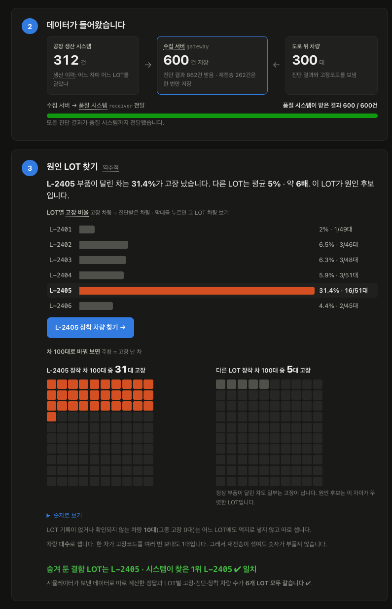
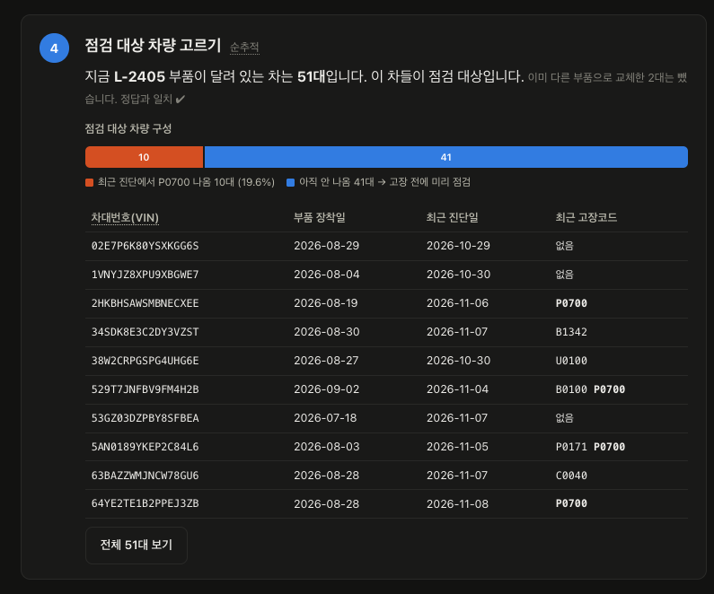

# Vehicle Diagnostic Gateway

**차량 진단 결과(고장코드)와 생산 이력(부품 LOT)을 연결해, 고장이 몰린 부품 LOT를 "원인 후보"로 찾아 주는 게이트웨이입니다.**

재전송·서버 중단·응답 유실이 섞여도 진단 결과는 한 번만 저장되고 품질 시스템에 누락 없이 전달됩니다.
그래서 LOT별 고장 차량 수가 부풀거나 빠지지 않고, 그 숫자로 원인 후보를 고를 수 있습니다.



> 제조 MES 백엔드에서 생산 이력 추적, 고객사별 검사 정책, 외부 시스템 연계를 개발한 경험을 차량 진단 데이터에 적용한 개인 프로젝트입니다. 실제 차량 통신과 실제 생산 시스템 대신 시뮬레이터가 만든 가상 데이터를 사용합니다.

## 왜 필요한가요

품질 부서는 "변속기 제어기(TCM)에서 고장코드 P0700이 늘었다"는 신호를 받으면 **어느 부품 묶음(LOT)이 문제인지**, **그 LOT가 지금 어느 차에 달려 있는지**를 알아야 합니다.

이 질문에 답하려면 두 가지가 필요합니다.

1. **연결:** 차에서 올라오는 진단 결과와 공장의 생산 이력(어느 차에 어느 LOT 부품을 언제 달았나)을 이어야 합니다.
2. **믿을 수 있는 숫자:** 차량 통신은 불안정해서 같은 진단 결과가 여러 번 올라옵니다. 이를 그대로 세면 특정 LOT의 고장 건수가 부풀고, 반대로 전달 중 유실되면 고장이 빠집니다. 숫자가 흔들리면 엉뚱한 LOT를 의심하게 됩니다.

이 프로젝트는 처음에 2번(데이터 정합성: 중복·누락 없는 수집과 전달)을 만들었고, 그 위에 1번(LOT 순·역추적)을 올렸습니다.

## 어떻게 원인 후보를 찾나요

| 단계 | 하는 일 |
| --- | --- |
| **1. 생산 이력 수신** | 차량별 부품 장착 이력(VIN, ECU, 부품 시리얼, LOT, 장착·탈거 시각)을 받아 보관합니다. 부품을 교체한 차는 교체 전후 기간이 모두 남습니다. |
| **2. 진단 결과 수집** | 차량의 ECU별 고장코드를 받습니다. 단말 ID·이벤트 ID가 같고 내용도 같으면 재전송으로 보고 다시 저장하지 않습니다. 키는 같은데 내용이 다르면 거부(409)합니다. |
| **3. 역추적 (고장 → LOT)** | 기간 안에 해당 ECU를 진단받은 차량을 LOT별로 나누고, **LOT별 고장 비율 = 고장 차량 수 ÷ 진단받은 차량 수**를 계산합니다. 다른 LOT보다 비율이 뚜렷이 높은 LOT가 원인 후보입니다. |
| **4. 순추적 (LOT → 차량)** | 원인 후보 LOT가 **지금** 달려 있는 차량을 골라 점검 대상으로 보여 줍니다. 이미 다른 부품으로 교체한 차는 뺍니다. |
| **5. 품질 시스템 전달** | 진단 결과의 고장코드와 점검 대상(캠페인)을 품질 시스템에 전달합니다. 전달은 수집과 분리돼 있어 품질 시스템이 멈춰도 추적은 계속됩니다. |



### 계산 규칙

추적 결과는 아래 규칙을 따릅니다. 응답에도 같은 설명을 함께 내려 줍니다.

| 항목 | 규칙 | 이유 |
| --- | --- | --- |
| 세는 단위 | 진단 **건수**가 아니라 **차량 수** | 한 차가 같은 고장을 여러 번 보내도 고장 차는 1대입니다. 재전송이 섞여도 비율이 부풀지 않습니다. |
| 어느 LOT로 셀지 | 고장 차량은 **처음 고장이 난 시각**, 정상 차량은 **기간 내 마지막 진단 시각**에 달려 있던 부품의 LOT | 부품을 교체한 차를 교체 후 LOT로 잘못 세지 않기 위해서입니다. |
| LOT를 알 수 없는 차 | "LOT 미확인·이력 없음·이력 모호(기간이 겹침)"로 **따로** 셉니다 | 어느 LOT에 억지로 넣으면 특정 LOT 숫자가 왜곡됩니다. 화면에 별도 건수로 보여 줍니다. |
| 표본이 적은 LOT | 진단 차량이 20대 미만이면 "표본 부족"으로 표시하고 순위에서 뒤로 보냅니다 | 3대 중 1대 고장(33%) 같은 숫자로 원인을 단정하지 않기 위해서입니다. |
| 조회 기간 | 기본 최근 30일, 최대 90일 | 전체 기간을 매번 집계하지 않도록 범위를 제한합니다. |

## 강점: 정합성이 받쳐 주는 추적

추적 숫자는 결국 저장된 진단 결과를 세는 것이라, **수집과 전달이 정확해야 추적도 정확**합니다. 아래 장애 상황에서도 숫자가 유지되도록 만들었고, 각 항목은 실제 프로세스로 재현해 확인했습니다.

| 장애 상황 | 그대로 두면 생기는 문제 | 처리 방식 | 추적에 미치는 효과 |
| --- | --- | --- | --- |
| 통신 불안정으로 **같은 진단 결과가 다시 옴** | 같은 고장이 두 번 저장됨 | 단말 ID·이벤트 ID와 내용 해시로 재전송을 알아보고 기존 결과를 돌려줌 | 고장 차량 수·LOT별 비율이 부풀지 않음 |
| **과거 진단 결과가 늦게 도착** | ECU 최신 상태가 과거 고장으로 되돌아감 | 수신 시각이 아니라 실제 진단 시각으로 최신 상태를 판단 | 순추적의 "최근 고장코드"가 과거로 돌아가지 않음 |
| 진단 결과 저장 직후 **서버가 멈춤** | 저장은 됐지만 품질 시스템에는 전달되지 않음 | 진단 결과와 전송 예약(outbox)을 **한 트랜잭션**으로 저장하고, 재시작 후 이어서 전송 | 품질 시스템 쪽 고장 기록이 빠지지 않음 |
| 품질 시스템이 저장했는데 **응답이 유실됨** | 게이트웨이가 다시 보내 품질 건이 중복 생성 | 품질 시스템이 이벤트 ID로 이미 받은 건을 걸러 냄 | 품질 시스템 쪽에서도 같은 고장이 두 번 잡히지 않음 |
| 품질 시스템이 **장시간 중단** | 진단 접수까지 같이 막힘 | 접수와 전달을 분리하고, 전송은 간격을 늘려 재시도, 한도를 넘으면 운영자 재처리로 넘김 | 수집 서버 데이터로 추적은 계속 가능, 전달만 밀림 |

**"정확히 한 번 전송"이 아닙니다.** 네트워크 너머로 정확히 한 번 보내는 것은 보장할 수 없습니다. 이 프로젝트는 **필요하면 다시 보내고(at-least-once), 받는 쪽에서 중복을 걸러(멱등 처리)** 결과적으로 한 번만 반영되게 합니다. 중복 방어를 끈 비교 시나리오(S12)에서는 실제로 중복 품질 건이 생기는 것도 함께 확인합니다.

## 이 결과를 어떻게 읽어야 하나요 (한계)

과장 없이 말하면, 이 프로젝트가 보여 주는 것과 보여 주지 않는 것은 다음과 같습니다.

- **원인 확정이 아니라 원인 후보입니다.** LOT별 고장 비율을 비교해 눈에 띄게 높은 LOT를 알려 줄 뿐, 그 LOT가 고장의 원인이라고 증명하지 않습니다. 실제 판단은 부품 분석 같은 후속 조사가 필요합니다.
- **통계 검정은 하지 않습니다.** 비율 비교와 "표본 부족(20대 미만)" 표시만 있습니다. p-value나 신뢰구간은 계산하지 않으므로, 결함이 약하거나 차량 수가 적으면 우연한 고장과 구분이 어려울 수 있습니다.
- **한 번에 ECU 하나·고장코드 하나만 봅니다.** 여러 부품이나 주행 환경 같은 다른 요인이 함께 작용하는 경우는 다루지 않습니다.
- **데이터는 가상입니다.** 시뮬레이터가 한 LOT에 결함을 숨겨 데이터를 만들고, 시스템이 찾은 1위 LOT가 그 LOT(기대값)와 같은지 확인합니다. LOT별 숫자는 시뮬레이터가 실제로 보낸 데이터로 Python에서 같은 규칙을 따로 계산한 기대값을 SQL 결과와 대조합니다. 실제 현장 데이터로 검증한 것은 아닙니다.
- **생산 이력은 받은 그대로 믿습니다.** 같은 시리얼을 같은 자리에 다시 장착하면 이전 기간을 덮어써 재장착 회차는 남지 않습니다. 장착 기간이 겹치는 이력은 고치지 않고 "이력 모호"로 드러냅니다.

## 직접 확인해 보기

데모 화면([front_v2](front_v2/README.md))에서 버튼 몇 번으로 위 흐름을 그대로 재현합니다.

1. 차량 수와 결함을 숨길 LOT(기본 무작위)를 고르고 데이터를 보냅니다. 시뮬레이터가 미리 만든 데이터를 실제 gateway API로 약 15초에 걸쳐 보내고, 통신 재전송 30%도 섞여 들어갑니다.
2. 보내는 동안 화면이 1초마다 gateway 역추적 API를 불러, DB에 쌓이는 만큼 LOT별 고장 비율이 바뀌는 것을 봅니다. 재전송분이 들어오는 동안에는 숫자가 움직이지 않습니다.
3. 전송이 끝나면 원인 후보를 확인하고, 결함을 심어 둔 LOT(기대값)와 비교합니다.
4. 원인 후보 LOT가 지금 달린 차량(점검 대상)을 봅니다.
5. 화면 아래에서 두 DB에 실제로 쌓인 건수를 확인합니다.

장애 주입(서버 강제 종료, 품질 시스템 중단, 응답 유실, 서버 2대 동시 실행)과 운영 재처리는 장애 실험 콘솔([front](front/README.md))에서 따로 재현합니다.

## 실행해 보기

```sh
python3 -m venv .venv && .venv/bin/pip install -r scripts/requirements.txt
.venv/bin/python -m scripts.services up      # PostgreSQL (Docker)
.venv/bin/python -m scripts.services build   # 서버 빌드 (JDK 17)
.venv/bin/python front_v2/server.py          # LOT 추적 데모 http://127.0.0.1:8071
.venv/bin/python front/server.py             # 장애 실험 콘솔 http://127.0.0.1:8070
```

데모 화면 상단에서 꺼진 서비스를 켤 수 있습니다. 자세한 내용은 [개발 환경 및 실행 안내](docs/getting-started.md)를 참고하세요.

## 구성과 기술

| 구성 | 역할 |
| --- | --- |
| **진단 게이트웨이** | 진단 결과 수집·검증, 생산 이력 수신, LOT 순·역추적, 캠페인 생성, 품질 시스템 전송(outbox)과 재처리 |
| **가상 품질 시스템** | 전달받은 고장코드를 품질 건으로, 캠페인을 점검 대상으로 반영하고 중복 수신을 걸러 냄 |
| **시뮬레이터·데모** | 결함 LOT를 숨긴 차량군 생성, LOT 추적 데모 화면, 장애 주입 콘솔 ([simulator](simulator/README.md) · [front_v2](front_v2/README.md) · [front](front/README.md) · [scripts](scripts/README.md)) |

| 주요 API | 설명 |
| --- | --- |
| `POST /api/v1/diagnostic-results` | 진단 결과 수집 (재전송 멱등 처리) |
| `POST /api/v1/production/vehicle-parts` | 부품 장착 이력 일괄 반영 |
| `GET /api/v1/trace/lots?ecuId=&dtcCode=` | 역추적: LOT별 고장 비율과 원인 후보 |
| `GET /api/v1/trace/lots/{lotNo}/vehicles?ecuId=` | 순추적: LOT가 현재 장착된 차량 |
| `POST /api/v1/campaigns` | 점검 대상 스냅샷 생성 후 품질 시스템 전달 |

**사용 기술** · Java 17 / Spring Boot 3.5 / MyBatis / PostgreSQL 16 / Flyway / Docker / JUnit 5 · Testcontainers / Python

---

[상세 설계](docs/architecture/implementation-notes.md) · [개발 환경 및 실행 안내](docs/getting-started.md) · [검증 결과](docs/results.md) · [전체 문서](docs/README.md)
