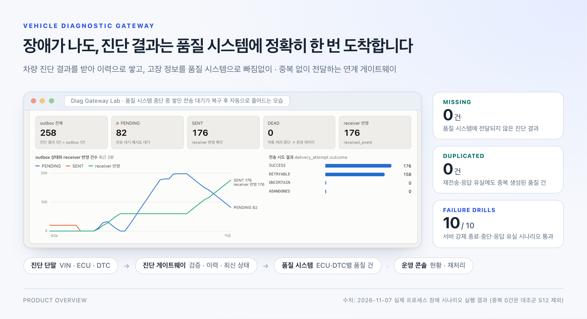
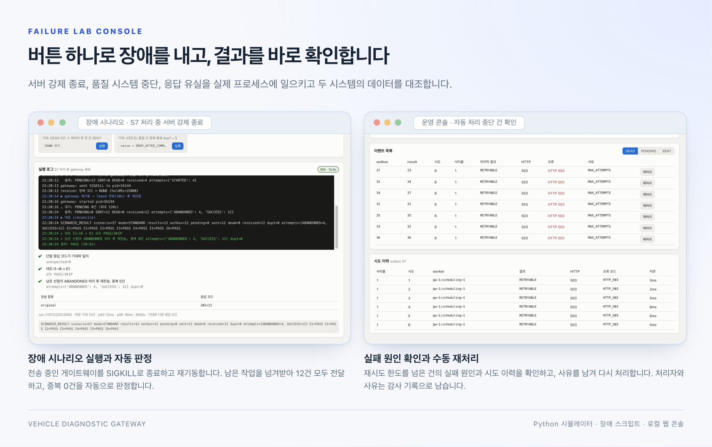
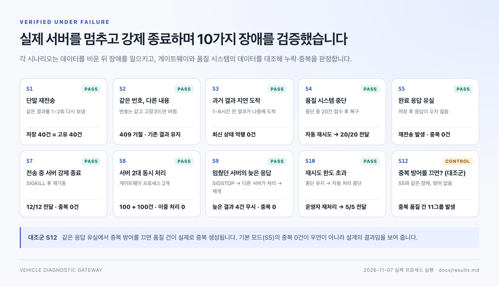

# Vehicle Diagnostic Gateway

**차량 진단 결과를 받아 이력으로 관리하고, 고장 정보를 품질 시스템에 빠짐없이 · 중복 없이 전달하는 연계 게이트웨이입니다.**



## 왜 필요한가요

차량 한 대의 진단 결과에는 여러 ECU(전자제어장치)의 정보와 DTC(고장코드)가 들어 있습니다. 품질 부서는 이 고장코드를 품질 건으로 등록해 원인을 추적합니다.

문제는 두 시스템을 잇는 구간입니다. 서버가 멈추거나 응답이 끊기면 **진단 결과가 품질 시스템에 도착하지 않거나 같은 고장이 두 번 등록**됩니다. 늦게 도착한 과거 결과가 차량의 현재 상태를 덮어쓰기도 합니다.

Vehicle Diagnostic Gateway는 이 구간을 맡습니다. 진단 결과를 차량별 이력으로 보존하고, 품질 시스템이 중단되거나 응답이 사라져도 **모든 진단 결과를 한 번씩만** 전달합니다.

> 제조 MES 백엔드에서 고객사별 검사 정책, 생산 이력 추적, 외부 시스템 연계를 개발한 경험을 차량 진단 데이터에 적용해 만든 프로젝트입니다.

## 무엇을 하나요


| 기능 | 하는 일 |
| --- | --- |
| **진단 결과 수집** | 차량 식별번호(VIN), 진단 시각, ECU 정보, SW 버전, 고장코드를 받아 저장합니다. 같은 결과가 다시 들어오면 기존 결과를 돌려줍니다. |
| **브랜드별 검증** | 모든 차량에 적용하는 공통 규칙과 브랜드별 필수 항목을 나눠 검사합니다. 예를 들어 특정 브랜드는 모든 ECU에 SW 버전이 있어야 합니다. |
| **차량 진단 이력** | 진단 당시의 ECU별 결과를 그대로 보존하고 ECU별 최신 상태를 따로 관리합니다. 과거 결과가 늦게 도착해도 최신 상태는 과거로 돌아가지 않습니다. |
| **품질 시스템 연계** | ECU·고장코드를 품질 시스템에 전달합니다. 같은 결과가 여러 번 전달돼도 품질 건은 한 번만 생깁니다. |
| **연계 현황·재처리** | 전송 현황, 실패 원인, 시도 이력을 조회합니다. 일시적인 장애는 자동으로 재시도하고 자동 처리가 멈춘 건은 사유를 남겨 다시 처리합니다. |

## 장애가 나도 연계는 이어집니다

| 장애 상황 | 발생할 수 있는 문제 | 해결 방식 |
| --- | --- | --- |
| **진단 결과를 저장한 뒤 품질 시스템에 보내기 전에 서버가 멈춤** | 단말에는 접수가 완료됐지만 품질 시스템에는 전달되지 않은 채 누락될 수 있습니다. | **진단 결과와 전송 예약을 함께 저장**합니다. 저장이 완료된 건은 서버를 다시 시작한 뒤에도 전송 대상으로 남아 처리를 이어갑니다. |
| **품질 시스템이 저장을 마쳤지만 네트워크가 끊겨 완료 응답을 받지 못함** | 게이트웨이가 실패로 판단해 다시 보내면 같은 품질 건이 두 번 이상 생성될 수 있습니다. | **수신 기록의 고유 번호와 내용을 확인**해 이미 처리한 데이터는 다시 등록하지 않습니다. 재전송돼도 기존 처리 결과를 반환합니다. |
| **품질 시스템이 장시간 점검이나 장애로 중단됨** | 진단을 받을 때마다 상대 응답을 기다리면 진단 접수까지 지연될 수 있습니다. | **진단 접수와 외부 전송을 분리**합니다. 전송 실패 시 대기 시간을 늘려 다시 시도하고 한도를 넘으면 자동 전송을 중단해 운영자가 확인할 수 있도록 남깁니다. |
| **네트워크 지연으로 과거 진단 결과가 나중에 도착함** | 현재 정상인 ECU의 최신 상태가 과거 고장 상태로 덮어써질 수 있습니다. | **수신 시각 대신 실제 진단 시각으로 최신 상태를 판단**합니다. 과거 결과는 이력에 보관하고 최신 상태는 더 최근의 진단 결과로만 갱신합니다. |
| **자동 전송이 중단된 데이터에 후속 조치가 필요함** | 개발자가 저장된 데이터를 직접 수정해 복구해야 하고 누가 왜 다시 처리했는지 기록이 남지 않을 수 있습니다. | **운영용 재처리 기능**으로 실패 원인과 시도 이력을 확인한 뒤 다시 처리합니다. 재처리 요청자와 사유도 함께 기록합니다. |

## 직접 장애를 내고 확인할 수 있습니다



함께 제공하는 웹 콘솔에서 가상 단말 데이터를 보내고 버튼으로 장애를 일으킵니다. 서버 강제 종료, 품질 시스템 중단, 응답 유실, 서버 2대 동시 실행을 재현할 수 있습니다. 시나리오가 끝나면 게이트웨이와 품질 시스템의 데이터를 대조해 누락과 중복을 자동으로 판정합니다.

## 검증 결과



장애 시나리오 10가지를 실제 서버 프로세스와 PostgreSQL로 재현했고 모두 기대한 결과가 나왔습니다. 같은 시나리오를 JUnit·Testcontainers 통합 테스트로도 검증합니다. 실행 기록은 [검증 결과](docs/results.md)에 있습니다.

## 실행해 보기

```sh
python3 -m venv .venv && .venv/bin/pip install -r scripts/requirements.txt
.venv/bin/python -m scripts.services up      # PostgreSQL (Docker)
.venv/bin/python -m scripts.services build   # 서버 빌드 (JDK 17)
.venv/bin/python front/server.py             # 콘솔 http://127.0.0.1:8070
```

콘솔에서 서버를 시작하고 장애 시나리오의 "실행"을 누르면 됩니다. 자세한 내용은 [개발 환경 및 실행 안내](docs/getting-started.md)를 참고하세요.

## 구성과 기술

| 구성 | 역할 |
| --- | --- |
| **진단 게이트웨이** | 진단 결과 수집·검증, 이력·최신 상태 관리, 품질 시스템 전송과 재처리 |
| **가상 품질 시스템** | 전달받은 ECU·고장코드를 품질 건으로 반영하고 중복 수신을 걸러 냄 |
| **장애 실험 콘솔** | 가상 단말, 장애 주입, 두 시스템 데이터 대조 ([simulator](simulator/README.md) · [scripts](scripts/README.md) · [front](front/README.md)) |

**사용 기술** · Java 17 / Spring Boot 3.5 / MyBatis / PostgreSQL 16 / Flyway / Docker / JUnit 5 · Testcontainers / Python

실제 차량 통신 대신 가상 진단 데이터를 사용합니다.

---

[상세 설계](docs/architecture/implementation-notes.md) · [개발 환경 및 실행 안내](docs/getting-started.md) · [검증 결과](docs/results.md) · [전체 문서](docs/README.md)
