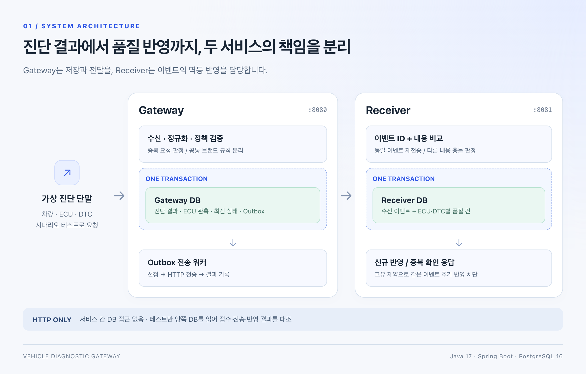
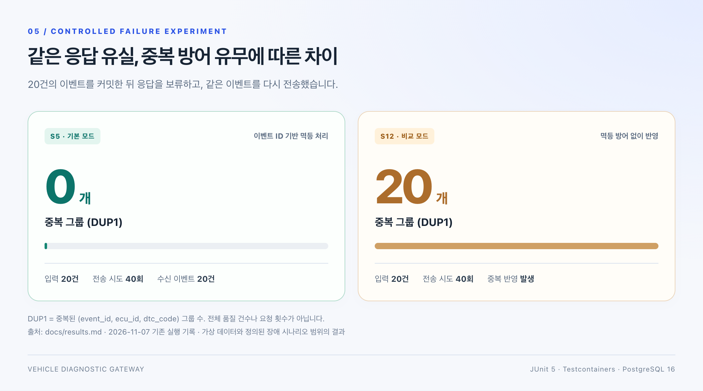
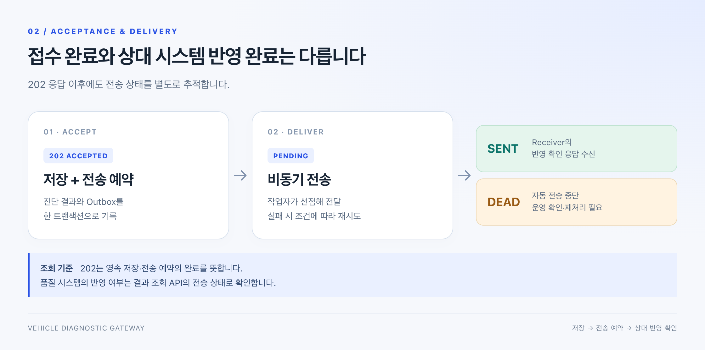
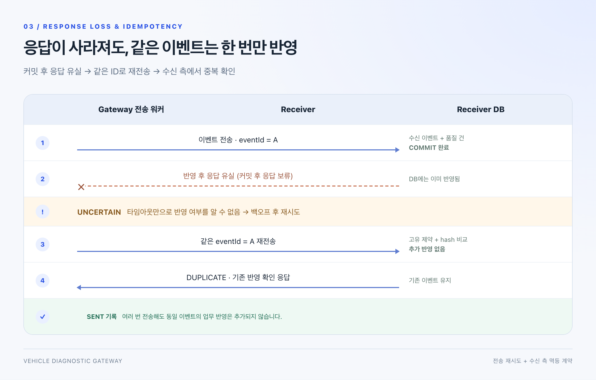
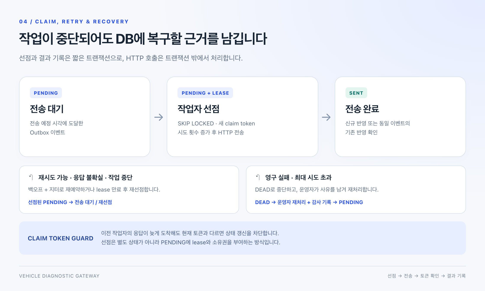

# 구현 상세와 검증 요약

**차량 진단 결과를 품질 시스템으로 연결하는 백엔드 프로젝트**

저장과 전송 예약은 함께, 재전송의 중복 방지는 수신 측까지.

`Java 17` · `Spring Boot 3.5` · `PostgreSQL 16` · `MyBatis` · `Testcontainers`

---

## 전체 구조

두 서비스는 **HTTP로만 통신**하며 서로의 DB를 읽지 않습니다. 테스트만 두 DB를 읽어 접수·전송·반영 건수와 중복 여부를 대조합니다. 로컬 환경에서는 하나의 PostgreSQL 인스턴스에 두 논리 DB를 분리했습니다.

## 검증한 결과

| 전체 테스트 | 응답 유실 후 중복 그룹 | 중단·실패 작업 복구 |
| :---: | :---: | :---: |
| **165개 성공** | **기본 0개 / 비교 모드 20개** | **lease 회복 · 수동 재처리 검증** |
| 단위 50개 + 통합 115개 | 같은 입력 20건 · 전송 시도 40회 | 작업자 중단 · 최대 시도 초과 재현 |

2026-11-07 기존 실행 기록 기준입니다. `DUP1`은 중복된 `(event_id, ecu_id, dtc_code)` 그룹 수이며, 기본 모드의 정의된 시나리오에서 이벤트 누락·중복 반영 0건을 확인했습니다.

## 왜 만들었나요?

제조 MES에서 고객사별 정책과 DB 기반 재처리를 구현한 경험을 차량 진단 데이터 연계로 확장한 개인 프로젝트입니다. 기존 재처리 구조에서 남았던 두 과제, **업무 저장과 전송 예약 사이의 누락**과 **상대 시스템의 중복 반영**을 직접 다뤘습니다.

가상 진단 결과를 받아 독립된 가상 품질 시스템에 전달하고, 장애를 주입해 양쪽 DB의 결과를 대조합니다. 핵심 질문은 **“보냈는가?”에서 “상대가 어떻게 반영했는가?”까지 확인할 수 있는가**입니다.

## 접수와 반영은 다른 상태입니다

`202`는 Gateway에 결과와 전송 예약이 저장됐다는 뜻입니다. 품질 시스템의 반영 완료를 뜻하지 않습니다. 결과 조회 API에서 전송 상태를 별도로 확인합니다.

## 핵심 설계

### 1. 진단 결과와 전송 예약을 함께 저장

수신 처리는 **정규화 → 중복 판정 → 공통·브랜드 검증 → 저장** 순서로 진행합니다. 진단 결과·최신 상태·Outbox는 같은 트랜잭션에 기록해, 저장 성공 시 전송할 이벤트도 함께 남깁니다.

| 경계 | 처리 기준 |
| --- | --- |
| 같은 단말·이벤트 ID, 같은 내용 | 정규화한 payload hash로 동일 요청을 판정하고 기존 결과 반환 |
| 같은 단말·이벤트 ID, 다른 내용 | `409 Conflict`로 거부하고 기존 결과 유지 |
| 과거 진단 결과가 늦게 도착 | 이력은 보존하고 최신 상태가 과거로 돌아가지 않도록 조건부 UPSERT |
| 공통 검증 | ECU 필수, ECU·DTC 중복 금지, 미래 시각 허용 범위 확인 |
| 브랜드별 정책 | `ResultValidationPolicy`로 분리; `BRAND_A`는 모든 ECU의 SW 버전 필수 |

**선택 이유:** 고객사마다 달라지는 요건과 모든 요청이 지켜야 하는 규칙의 경계를 나눴습니다. 적용 정책 코드를 기록해 어떤 규칙으로 수신했는지 확인할 수 있습니다.

### 2. 응답 유실은 재전송하고, 중복 반영은 수신 측에서 차단

Outbox는 전송할 이벤트를 남깁니다. 상대가 이미 반영한 뒤 응답이 사라지는 상황까지 다루기 위해 Receiver의 멱등 처리를 함께 구현했습니다.

**처리 계약:** 전송은 반복될 수 있습니다. Receiver는 이벤트 ID와 payload hash를 확인하고, 수신 기록과 품질 건을 한 트랜잭션으로 저장합니다. 동일 이벤트의 동일 내용은 추가 반영하지 않고, 내용이 다르면 충돌로 처리합니다.

### 3. 전송 중단과 재처리를 DB 상태로 관리

선점은 별도 상태값이 아니라 `PENDING` 이벤트에 lease와 소유권을 부여하는 방식입니다. lease 만료 후 다시 선점할 수 있으며, **이전 작업자의 늦은 결과는 현재 claim token과 다르면 상태를 갱신하지 못합니다.**

| 장치 | 목적 |
| --- | --- |
| `FOR UPDATE SKIP LOCKED` | 동시 작업자가 같은 전송 대상을 선점하지 않도록 처리 |
| 짧은 선점·결과 기록 트랜잭션 | HTTP 호출 동안 DB 트랜잭션을 유지하지 않음 |
| 지수 백오프 + 지터 | 재시도 간격을 늘리고 재시도 시점을 분산 |
| lease + claim token | 중단 작업을 회수하고 이전 소유자의 결과 갱신을 차단 |
| 시도 이력 + 재처리 감사 기록 | 실패 원인과 운영자가 다시 처리한 근거를 추적 |

## 기술 선택과 트레이드오프

| 결정 | 선택한 이유와 경계 |
| --- | --- |
| 메시지 브로커 대신 PostgreSQL Outbox | 업무 저장과 전송 예약의 원자성·수신 측 멱등성에 집중했습니다. 별도 브로커는 도입하지 않았습니다. |
| 작업자 ID와 별개인 claim token | 같은 작업자가 재선점해도 이전 실행의 지연 응답을 구별해야 하므로, 선점마다 새 토큰을 발급합니다. |
| 이벤트 간 전송 순서 미보장 | 재시도로 도착 순서가 바뀔 수 있습니다. 최신 상태는 도착 순서 대신 진단 발생 시각으로 판단합니다. |
| H2 대신 실제 PostgreSQL 테스트 | `SKIP LOCKED`, `ON CONFLICT`, `jsonb` 등 사용한 DB 동작을 그대로 검증합니다. |

## 장애를 넣고 무엇을 확인했나요?

JUnit 5와 Testcontainers로 **실제 PostgreSQL 16**에서 검증합니다. Gateway 통합 테스트가 Receiver를 띄우고 장애를 주입한 뒤, 두 DB의 접수·전송·반영 결과를 대조합니다.

| 시나리오 | 입력·장애 | 확인한 결과 |
| --- | --- | --- |
| 중복·충돌·지연 도착 (S1~S3) | 동일 요청 5개 동시 전송, 같은 키의 다른 내용, 과거 결과 도착 | 1건만 접수, 충돌 시 원본 유지, 최신 상태 역전 방지 |
| 수신 서버 중단 (S4) | 20건 전송 중 `503` → 복구 | 재시도 후 20건 반영, 중복 0 |
| 응답 유실 (S5) | 20건 커밋 후 응답 보류 → 재전송 | 전송 시도 40회, 수신 이벤트 20건, 중복 그룹 0 |
| 작업자 중단·경합 (S7~S9) | 선점 후 중단, 100건 동시 선점, 이전 토큰의 지연 결과 | lease 회복, 선점 중첩 없음, 이전 결과 갱신 차단 |
| 최대 시도 후 복구 (S10) | 5건 × 3회 실패 → 운영자 재처리 | DEAD 5건 확인 후 전송 성공, 감사 기록 5행 |

**확인한 범위:** 기본 모드의 정의된 장애 시나리오에서 이벤트 누락·중복 반영 0건을 확인했습니다. 작업 중 종료는 실제 프로세스를 강제 종료하지 않고 **선점 후 전송 생략 + lease 만료**로 모사했습니다. 가상 데이터·가상 수신 서버를 사용했으며 실제 차량 통신, 운영 API 인증, 운영 지표·경보는 구현 범위에 포함하지 않았습니다.

## 구현 모듈

| 모듈 | 책임 |
| --- | --- |
| [`gateway/`](../../gateway) | 진단 결과 수신, 정책 검증, Outbox 저장·전송, 운영 조회·재처리 |
| [`receiver/`](../../receiver) | 가상 품질 시스템, 멱등 반영, 장애 주입, 중복 방어 없는 비교 모드 |
| [`web-support/`](../../web-support) | 공통 응답, RFC 9457 오류 응답, `X-Request-Id` 추적 |

## 상세 문서·실행 방법

| 관심 주제 | 바로가기 |
| --- | --- |
| 직접 실행·빌드하기 | [개발 환경 및 실행 가이드](../getting-started.md) |
| 전체 구조와 책임 경계 | [아키텍처](overview.md) · [DB 설계](../db/README.md) |
| 요청 수신과 정책 분리 | [수신 구현](../plan/gateway/01-ingest-design/README.md) · [정책 코드](../../gateway/src/main/java/com/hopoong/diag/gateway/policy) |
| 선점·재시도·lease 회복 | [전송 구현](../plan/gateway/02-delivery-retry-design/README.md) · [전송 코드](../../gateway/src/main/java/com/hopoong/diag/gateway/delivery) |
| 멱등 반영과 장애 주입 | [Receiver 구현](../plan/receiver/03-receiver-design/README.md) · [Receiver 코드](../../receiver/src/main/java/com/hopoong/diag/receiver) |
| 테스트와 검증 근거 | [시나리오 테스트](../../gateway/src/integrationTest/java/com/hopoong/diag/gateway/scenario) · [실행 결과](../results.md) |
| 문서 전체 탐색 | [문서 가이드](../README.md) |
