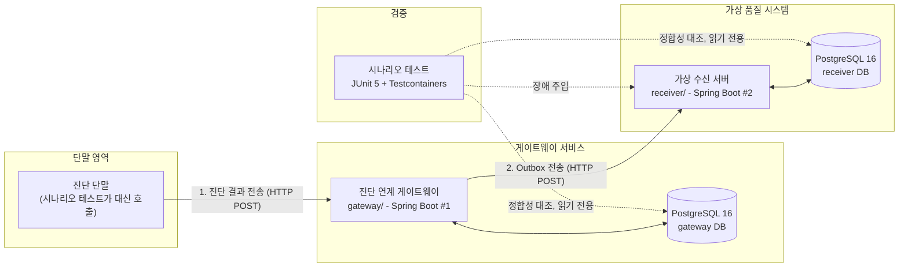

# 프로젝트 아키텍처 및 구성 요소 명세

> **문서 상태**: v1.1 (2026-11-06, 5일 범위 축소 반영)  
> **관련 문서**: [02-toy-project-scenario.md](../../temp/02-toy-project-scenario.md), [00_전체_설계.md](../../temp/설계/00_전체_설계.md)

이 문서는 **차량 진단 결과 연계 게이트웨이(vehicle-diag-gateway)** 프로젝트를 구성하는 애플리케이션(Spring Boot 2개), 시나리오 테스트, 데이터베이스의 역할과 협력 관계를 설명합니다.

---

## 1. 전체 구성도



---

## 2. 구성 요소별 상세 역할

### 2.1. Spring Boot 서버: 총 2개 서비스

게이트웨이만 단독으로 띄우지 않고, 전송 대상인 **외부 품질 시스템까지 독립된 Spring Boot 서비스**로 직접 개발합니다.

| 서비스명 | 위치 | 기술 스택 | 주요 역할 |
|---|---|---|---|
| **gateway** | `gateway/` | Java 17, Spring Boot 3.5, MyBatis, Flyway | • **진단 결과 수신 API** (`POST /api/v1/diagnostic-results`)<br/>• 단말 재전송·중복 수신 판단 (`device_id`, `event_id`, `payload_hash`)<br/>• 브랜드 정책(표준·BRAND_A)과 공통 검증 분리<br/>• **Transactional Outbox**: 결과 저장과 전송 예약을 한 트랜잭션으로 처리<br/>• **전송기**: `FOR UPDATE SKIP LOCKED` 선점, `claim_token`·lease, 지수 백오프 + 지터 재시도, 최대 시도 초과 시 `DEAD`<br/>• **운영 API**: `/ops/summary`, `/ops/events`, 시도 이력, `DEAD` 건 수동 재처리 |
| **receiver** | `receiver/` | Java 17, Spring Boot 3.5, MyBatis, Flyway | • **가상 품질 시스템 수신 API** (`POST /api/v1/quality-events`)<br/>• **수신 측 멱등성**: `received_event.event_id` PK + `ON CONFLICT DO NOTHING`으로 중복 반영 차단<br/>• **장애 주입 API** (`POST /admin/faults`, `chaos` 프로필에서만)<br/>  - `DOWN`: 503 점검 응답<br/>  - `DROP_AFTER_COMMIT`: DB 커밋 후 응답 보류 (응답 유실 재현)<br/>  - `NONE`: 정상<br/>• **비교 모드** (`naive-insert`): 중복 검사 없이 반영해 중복이 실제로 생김을 보여 줌 |

> [!NOTE]
> `gateway`와 `receiver`는 별도 애플리케이션(포트 분리)이며, 서로의 DB에 접근하지 않고 **HTTP REST API**로만 통신합니다. 두 DB를 함께 읽는 것은 테스트 코드의 정합성 대조뿐입니다.

---

### 2.2. 시나리오 테스트 (JUnit 5 + Testcontainers)

가상 단말·장애 주입·정합성 대조를 모두 gateway의 `integrationTest`에서 처리합니다. 별도 Python 도구나 셸 스크립트는 두지 않습니다.

| 역할 | 구현 | 설명 |
|---|---|---|
| **가상 단말** | 테스트 코드 | 정상 전송, 같은 요청 동시 재전송, 같은 ID 다른 내용(409), 과거 시각 지연 도착 요청을 직접 만든다 |
| **receiver 기동** | `SpringApplicationBuilder` | 같은 JVM에서 receiver를 랜덤 포트·`chaos` 프로필로 띄운다 |
| **전송 실행** | `DeliveryService.runOnce()` | 스케줄러를 끄고(`gateway.delivery.enabled=false`) 테스트가 직접 호출한다. 시간에 기대는 테스트를 만들지 않는다 |
| **처리 중 종료 모사** | 선점 후 전송 생략 + lease 만료 | 실제 프로세스 종료 없이 S7을 재현한다 |
| **정합성 대조** | `ReconcileAssertions` | 두 DB를 읽어 불변식 I1~I6과 중복 반영 수(DUP1)를 판정한다 |

검증하는 시나리오: S1 재전송, S2 충돌, S3 지연 도착, S4 수신 서버 중단, S5 응답 유실, S7 처리 중 종료, S8 동시 선점, S9 lease 초과(stale claim), S10 최대 시도 초과 후 수동 재처리, S12 중복 검사 없는 비교 실험. 상세는 [04_운영_검증_설계.md](../tmep/설계/04_운영_검증_설계.md).

---

### 2.3. 데이터베이스 및 인프라

| 구성 요소 | 기술 | 세부 설명 |
|---|---|---|
| **PostgreSQL 16** | Docker Compose(로컬 실행) / Testcontainers(테스트) | 인스턴스 하나에 `gateway`와 `receiver` 두 논리 데이터베이스를 분리합니다. H2 등 임베디드 DB를 쓰지 않고 실제 PostgreSQL의 `FOR UPDATE SKIP LOCKED`, `ON CONFLICT`, `jsonb`, 부분 인덱스를 그대로 검증합니다. |
| **docker-compose.yml** | Docker Compose | 로컬 개발용 PostgreSQL을 띄웁니다. 애플리케이션은 `bootRun`으로 실행합니다. |

---

## 3. 디렉토리 구조 요약

```text
vehicle-diag-gateway/
├─ settings.gradle           # 루트 Gradle 멀티 프로젝트 (web-support, gateway; receiver 추가 예정)
├─ web-support/              # 두 서비스가 공유하는 HTTP 응답·예외 처리·요청 추적 라이브러리
├─ gateway/                  # [Spring Boot #1] 진단 연계 게이트웨이
│  ├─ src/main/              # ingest, policy, delivery, ops, common 패키지
│  ├─ src/integrationTest/   # 시나리오 테스트, ReconcileAssertions
│  └─ build.gradle
├─ receiver/                 # [Spring Boot #2] 가상 품질 시스템 (장애 주입 포함)
│  ├─ src/
│  └─ build.gradle
├─ docs/
│  ├─ README.md              # 문서 전체 허브
│  ├─ architecture/          # 시스템 아키텍처 및 모듈 명세
│  │  ├─ overview.md         # (본 문서)
│  │  └─ web-support.md      # 공통 웹 모듈 명세
│  ├─ db/                    # DB 설계 명세 및 정합성 설계 (gateway-db, receiver-db)
│  ├─ convention/            # 개발 표준 및 컨벤션 (conventions.md)
│  └─ results.md             # 시나리오 수행 결과 (5일차 작성)
├─ temp/                     # 사전 기획 및 상세 설계
│  ├─ 01-resume-content.md
│  ├─ 02-toy-project-scenario.md
│  └─ 설계/
└─ docker-compose.yml        # 로컬 PostgreSQL
```

---

## 4. 왜 이런 구성인가

1. **Spring Boot를 2개 두는 이유**:
   게이트웨이의 핵심 가치는 "외부 시스템 전송 중 장애(중단, 응답 유실, 처리 중 종료)가 나도 결과가 유실되거나 중복 반영되지 않는다"를 증명하는 것입니다. 이를 검증하려면 **장애를 내고, 커밋한 뒤 응답을 끊는 가상 수신 서버(`receiver`)**와, 그 서버 쪽의 고유 제약이 실제로 중복을 막는지 확인할 별도 DB가 필요합니다.

2. **검증을 JUnit 한 가지로 모은 이유**:
   개발 기간이 5일이므로 Python simulator·reconcile 스크립트·docker 장애 스크립트를 따로 만들지 않았습니다. 같은 입력과 판정을 테스트 코드로 만들면 `.\gradlew.bat integrationTest` 한 번으로 모든 시나리오를 재현할 수 있고, 결과 수치도 테스트 실행 결과에서 바로 얻습니다.

3. **5일 범위에서 뺀 것**:
   Python 도구, 다중 gateway 컨테이너와 `docker kill` 시나리오, receiver의 `SLOW`·`ERROR_RATE` 모드, 지표·경보, 운영 API 인증. 각 항목을 뺀 이유는 설계 문서마다 마지막 절("v1.0에서 뺀 것")에 있습니다.
