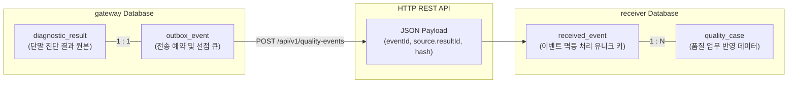

# 데이터베이스 아키텍처 및 정합성 설계 개요

> **문서 상태**: v1.0 (2026-11-06)  
> **관련 문서**: [gateway-db.md](gateway-db.md), [receiver-db.md](receiver-db.md), [overview.md](../architecture/overview.md)

이 문서는 **차량 진단 결과 연계 게이트웨이**의 데이터베이스 구성 원칙과 두 독립된 데이터베이스(`gateway` ↔ `receiver`) 간의 정합성 보장 메커니즘을 요약합니다.

---

## 1. 데이터베이스 구성 원칙

1. **독립된 2개의 논리적 Database (물리 인스턴스는 1개 공유)**
   - Docker Compose의 PostgreSQL 16 인스턴스 1개 안에 `gateway`와 `receiver` 데이터베이스를 분리하여 운영합니다.
   - 두 서비스는 상대방의 Database에 접근하지 않으며, 오직 **HTTP REST API**를 통해서만 통신합니다. (물리적 DB 분리 시뮬레이션)
2. **H2 미사용, PostgreSQL 16 전용 기능 활용**
   - 동시성 및 멱등성 보장을 위해 `FOR UPDATE SKIP LOCKED`, `INSERT ... ON CONFLICT`, `jsonb`, 부분 인덱스(Partial Index)를 적극 활용하며, 테스트 시에도 Testcontainers를 통해 실제 PostgreSQL 16 환경에서만 검증합니다.
3. **불변식 (Invariants)**
   - 수신 결과(`diagnostic_result`) = Outbox 이벤트(`outbox_event`) (1:1 관계)
   - 최종 반영 이벤트(`received_event`) = Outbox 완료 이벤트(`SENT`) (정합성 100% 일치)
   - 중복 전송이 발생해도 수신 서버 측 `quality_case`의 중복 반영은 **0건**이어야 함.

---

## 2. 두 DB 간의 논리적 연계 구조

두 DB 간에는 물리적 Foreign Key가 존재하지 않으며, 논리적 식별자(`event_id`)와 해시(`payload_hash`)를 통해 계약을 맺습니다.

### 상호 계약 (Data Contract)
| 계약 항목 | Gateway DB | Receiver DB | 설명 |
|---|---|---|---|
| **이벤트 식별자** | `outbox_event.event_id` (`uuid`) | `received_event.event_id` (`uuid` PK) | 시스템 간 고유 멱등 키. 게이트웨이가 발급하여 전송 |
| **출처 결과 ID** | `diagnostic_result.id` (`bigint`) | `received_event.source_result_id` (`bigint`) | 원본 추적용 논리 ID (FK 없음) |
| **내용 위변조 검증** | `diagnostic_result.payload_hash` (`char(64)`) | `received_event.payload_hash` (`char(64)`) | 동일 ID인데 내용이 바뀐 경우 `409 Conflict` 감지 |
| **차대번호** | `diagnostic_result.vin` (`varchar(17)`) | `received_event.vin` (`varchar(17)`) | 복합 FK로 `quality_case`와 일치 보장 |
| **품질 건수** | ECU별 DTC 코드 수 합 | `received_event.case_count` | 단일 이벤트당 생성된 `quality_case` 행 수 일치 검증 |

---

## 3. 서브 디렉토리 문서 안내

- [**01. Gateway DB 설계 요약 (gateway-db.md)**](gateway-db.md)
  - `diagnostic_result`, `ecu_observation`, `vehicle_ecu_latest`, `outbox_event`, `delivery_attempt`, `ops_action_log` 6개 테이블 상세 설계
  - `FOR UPDATE SKIP LOCKED` 선점 쿼리 및 상태 전이 규칙
- [**02. Receiver DB 설계 요약 (receiver-db.md)**](receiver-db.md)
  - `received_event`, `quality_case`, `quality_case_naive` 3개 테이블 상세 설계
  - `ON CONFLICT DO NOTHING` 기반 멱등 반영 메커니즘 및 장애 비교 검증(S12)

