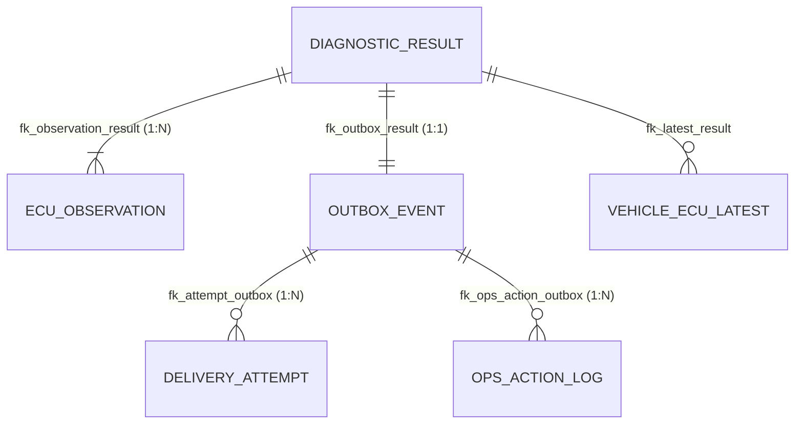

# Gateway 데이터베이스 설계 요약 (gateway-db)

> **문서 상태**: v1.0 (2026-11-06)  
> **관련 문서**: [README.md](README.md), [receiver-db.md](receiver-db.md)

진단 결과 수신, 원본 보관, 브랜드 검증, Transactional Outbox 전송 예약 및 선점, 운영자 재처리 감사를 담당하는 `gateway` 데이터베이스의 핵심 요약입니다.

---

## 1. ERD (Entity Relationship Diagram)



---

## 2. 테이블 정의 및 핵심 제약조건

총 6개의 테이블로 구성됩니다.

### 2.1. `diagnostic_result` (진단 결과 원본)
- 단말기가 전송한 원본 요청과 정규화 해시를 보관하며, 한 번 저장되면 **수정/삭제되지 않는 불변 테이블**입니다.
- **핵심 컬럼**:
  - `(device_id, event_id)`: 고유 제약 (`uq_result_device_event`)으로 단말 레벨의 중복 요청을 방지합니다.
  - `payload_hash`: SHA-256 해시값(소문자 64자). 같은 ID인데 내용이 변경된 요청을 감지(`409 Conflict`)합니다.
  - `policy_code`: 수신 시점에 적용된 검증 정책 및 버전 기록.
  - `raw_payload`: JSON 원본 (`jsonb`).

### 2.2. `ecu_observation` (ECU별 관측 결과)
- 결과 1건당 진단된 ECU별 고장 코드(DTC) 목록을 보관합니다.
- **핵심 제약**:
  - `uq_observation_result_ecu`: 한 결과 내에서 동일 ECU 중복 방지.
  - `ck_observation_dtc_count`: ECU당 최대 50개 DTC 허용 (`cardinality(dtc_codes) <= 50`).

### 2.3. `vehicle_ecu_latest` (차량-ECU별 최신 관측 상태)
- 차량(VIN)과 ECU 단위의 가장 최신 진단 상태를 유지합니다.
- **설계 포인트**: 네트워크 지연으로 인해 **과거 결과가 늦게 도착해도 최신 상태를 덮어쓰지 않도록** `occurred_at`이 기존 값보다 늦을 때만 조건부 UPSERT합니다.

### 2.4. `outbox_event` (전송 예약 및 선점 큐)
- 수신 트랜잭션과 원자적으로 묶여 생성되는 전송 큐 테이블입니다.
- **핵심 컬럼 & 제약**:
  - `status`: `PENDING` → `SENT` (성공 종료) / `DEAD` (최대 시도 초과 또는 재시도 불가 오류).
  - `event_id`: 수신 서버(receiver)로 보낼 고유 UUID (`ck_outbox_payload_event`로 payload 내부 ID와 일치 보장).
  - `claim_token`, `locked_by`, `locked_until`: 다중 워커 선점 시 안전한 lease 관리.
  - **부분 인덱스**: `ix_outbox_pending (next_attempt_at) WHERE status = 'PENDING'` → 전송 완료(`SENT`) 건이 수백만 건 쌓여도 선점 쿼리의 성능이 유지됩니다.

### 2.5. `delivery_attempt` (전송 시도 이력)
- 전송 워커가 수신 서버를 호출할 때마다 시도 횟수, 시작/종료 시각, 결과(`SUCCESS`, `RETRYABLE`, `NON_RETRYABLE`, `UNCERTAIN`), HTTP 응답 코드 등을 기록합니다.

### 2.6. `ops_action_log` (운영 감사 로그)
- `DEAD` 상태의 건을 운영자가 수동 재처리(`requeue`)할 때 **사유(reason)와 작업자(operator) 정보를 필수로 기록**하는 감사 테이블입니다.

---

## 3. 핵심 SQL 패턴

### 3.1. 최신 상태 조건부 UPSERT
```sql
INSERT INTO vehicle_ecu_latest (vin, ecu_id, result_id, occurred_at, dtc_codes)
VALUES (#{vin}, #{ecuId}, #{resultId}, #{occurredAt}, #{dtcCodes})
ON CONFLICT (vin, ecu_id) DO UPDATE
   SET result_id = EXCLUDED.result_id,
       occurred_at = EXCLUDED.occurred_at,
       dtc_codes = EXCLUDED.dtc_codes,
       updated_at = now()
 WHERE vehicle_ecu_latest.occurred_at < EXCLUDED.occurred_at; -- 과거 데이터가 덮어쓰지 않음
```

### 3.2. Outbox 선점 쿼리 (SKIP LOCKED)
여러 전송기 인스턴스가 락 충돌 없이 각자 대상을 즉시 선점합니다.
```sql
UPDATE outbox_event
   SET claim_token = #{claimToken},
       locked_by = #{workerId},
       locked_until = now() + (#{leaseSeconds} || ' seconds')::interval,
       attempt_count = attempt_count + 1
 WHERE id IN (
     SELECT id
       FROM outbox_event
      WHERE status = 'PENDING'
        AND next_attempt_at <= now()
        AND (locked_until IS NULL OR locked_until < now())
      ORDER BY next_attempt_at
      LIMIT #{batchSize}
        FOR UPDATE SKIP LOCKED
 )
 RETURNING *;
```

### 3.3. 전송 결과 안전 반영 (Stale Token 방지)
자신이 선점했던 `claim_token`이 유지되는 경우에만 성공/실패를 반영하여, lease 만료 후 늦게 끝난 요청이 최신 상태를 덮어쓰는 레이스 컨디션을 방지합니다.
```sql
UPDATE outbox_event
   SET status = 'SENT',
       sent_at = now(),
       claim_token = NULL,
       locked_by = NULL,
       locked_until = NULL
 WHERE id = #{id}
   AND claim_token = #{claimToken}; -- 선점 토큰이 일치해야만 커밋
```

