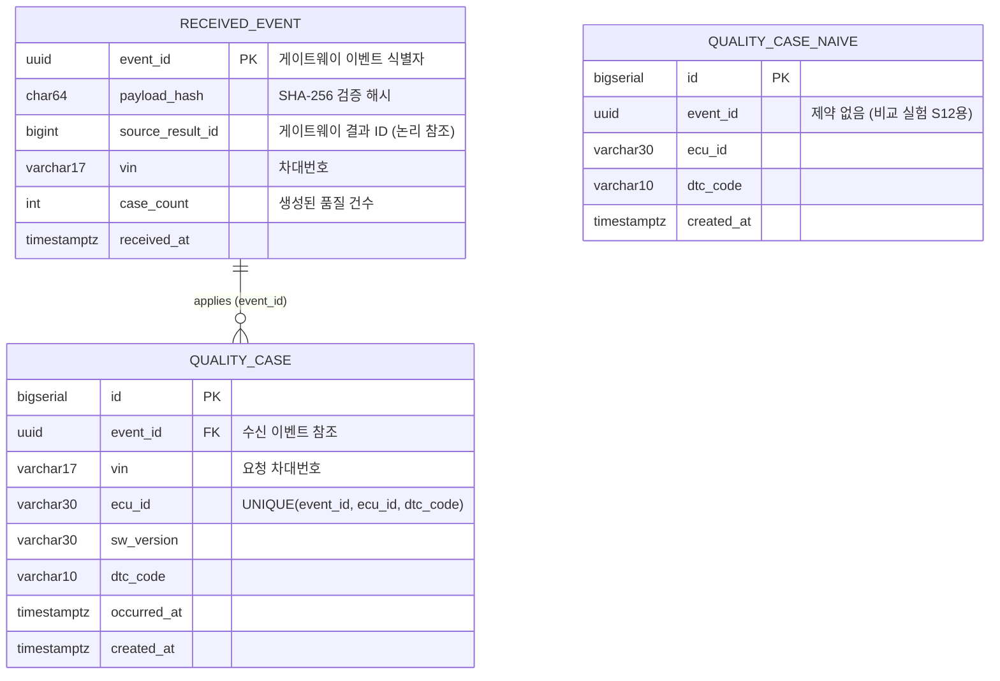

# Receiver 데이터베이스 설계 요약 (receiver-db)

> **문서 상태**: v1.0 (2026-11-06)  
> **관련 문서**: [README.md](README.md), [gateway-db.md](gateway-db.md)

Gateway로부터 품질 이벤트를 수신하여 **멱등성(Idempotency)**을 보장하며 반영하고, 장애 시나리오(S5·S12) 검증을 지원하는 가상 품질 시스템(`receiver`) 데이터베이스의 핵심 요약입니다.

---

## 1. ERD (Entity Relationship Diagram)



---

## 2. 테이블 정의 및 역할

총 3개의 테이블로 구성됩니다.

### 2.1. `received_event` (반영된 품질 이벤트 — 멱등 보장의 핵심 장치)
- 수신 서버가 처리 완료한 이벤트를 기록하는 테이블이며, **중복 반영을 원천 차단하는 유일한 방어선**입니다.
- **핵심 제약**:
  - `event_id` (`uuid` PK): 동일 이벤트가 네트워크 재시도나 지연으로 다시 들어와도 PK 충돌로 인해 트랜잭션 내에서 한 번만 처리됩니다.
  - `payload_hash`: 최초 수신된 요청의 정규화 SHA-256 해시값. 동일 `event_id`로 재전송되었을 때 내용이 같은지 검증(다르면 `409 Conflict`).
  - `case_count`: 이 이벤트로 인해 생성된 `quality_case` 건수를 기록하여 중복 응답 시에도 일치하는 통계를 반환.

### 2.2. `quality_case` (품질 분석 케이스 — 실제 업무 데이터)
- 이벤트 1건에 포함된 (ECU, DTC) 쌍마다 1행씩 생성되는 실질적인 품질 데이터입니다.
- **핵심 제약**:
  - `uq_case_event_ecu_dtc`: 동일 이벤트 내에서 같은 ECU, 동일 고장코드가 중복 생성되지 않도록 보장 (`UNIQUE(event_id, ecu_id, dtc_code)`).
  - 외래키: `event_id`가 `received_event(event_id)`를 참조합니다. `vin`은 요청에서 함께 저장합니다.

### 2.3. `quality_case_naive` (비교 실험 S12 전용 대조군 테이블)
- **설계 목적**: "만약 수신 서버에 멱등 방어 장치가 없다면 실제로 중복이 발생하는가?"를 증명하기 위한 비교 실험용 테이블입니다.
- **특징**: `received_event`를 거치지 않고 직접 INSERT되며, **의도적으로 FK와 UNIQUE 제약조건이 전혀 없습니다.** 응답 유실 후 게이트웨이가 재전송하면 데이터가 그대로 2배로 불어나는 것을 대조군으로 보여줍니다.

---

## 3. 수신 서버 멱등 반영 SQL 패턴

단일 데이터베이스 트랜잭션 안에서 다음과 같이 원자적으로 처리합니다.

```sql
-- 1단계: 이벤트 선점 시도 (멱등 키 삽입)
INSERT INTO received_event (event_id, payload_hash, source_result_id, vin, case_count, received_at)
VALUES (#{eventId}, #{payloadHash}, #{sourceResultId}, #{vin}, #{caseCount}, now())
ON CONFLICT (event_id) DO NOTHING;

-- 2단계: 결과 분기
-- (A) 영향 받은 행(Affected Rows) == 1: 신규 이벤트
--     -> quality_case 일괄 INSERT 후 200 OK (성공 반영)
INSERT INTO quality_case (event_id, vin, ecu_id, sw_version, dtc_code, occurred_at)
VALUES (...);

-- (B) 영향 받은 행(Affected Rows) == 0: 이미 수신된 중복 이벤트
--     -> 기존 행의 payload_hash 조회
--     -> hash 일치 시: 업무 반영 건너뛰고 기존 caseCount와 함께 200 OK 응답 (멱등 보장)
--     -> hash 불일치 시: 409 Conflict 응답 (동일 ID 변조 감지)
```

---

## 4. 장애 시나리오 검증 대응 (S5 vs S12)

| 시나리오 | 조건 | 정상 설계 (`quality_case`) | 대조군 (`quality_case_naive`) |
|---|---|---|---|
| **S5 (응답 유실)** | `DROP_AFTER_COMMIT` (수신 서버가 DB 커밋 후 응답을 보류하여 클라이언트 타임아웃 유도) | 게이트웨이가 타임아웃으로 재전송하더라도 **중복 반영 0건** (기존 이벤트 인정) | — |
| **S12 (비교 실험)** | 멱등 장치가 없는 시스템에 동일한 재전송 발생 | — | **동일 이벤트의 데이터가 중복으로 쌓임 (N건 초과)** |

